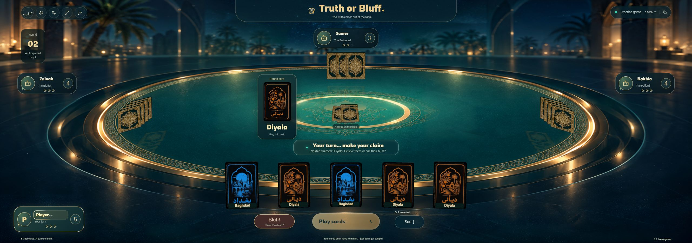
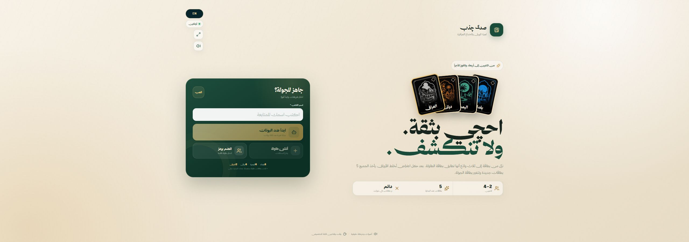

# ⁧صدگ چذب⁩

⁧**احچي بثقة. ولا تنكشف.**⁩

[**⁧▶ العب الآن⁩**](https://sadig-chathib.onrender.com) · [English](README.md)

⁧لعبة ورق وخداع عراقية من لاعبين إلى أربعة، تجمع الادعاء والاعتراض وعقوبات الفناجين. بطاقات بغداد والبصرة وديالى تمنحها هويتها المحلية على طاولة بطابع القصور. العب مع أصدقائك أو ضد ثلاثة لاعبين آليين من المتصفح.⁩

## ⁧عن اللعبة⁩

- ⁧**أصدقاء أو لاعبين آليين:** أنشئ طاولة وادعُ أصدقاءك، انضم برمز، أو ابدأ مباراة تدريب.⁩
- ⁧**خداع بطابع عراقي:** بطاقات محافظات، وبطاقات العراق البديلة، وبطاقة جولة متغيرة.⁩
- ⁧**العربية والإنكليزية:** اختر لغتك دون مغادرة المباراة.⁩
- ⁧**للحاسوب والهاتف:** بطاقات متحركة ومؤثرات صوتية، مع إمكانية ضبط الوقت والفناجين.⁩

## ⁧طريقة اللعب⁩

1. ⁧افتح [اللعبة](https://sadig-chathib.onrender.com)، أدخل اسمًا مستعارًا، واختر طريقة اللعب.⁩
2. ⁧يبدأ كل لاعب بخمس بطاقات. نزّل من بطاقة إلى ثلاث بطاقات مقلوبة وادّعِ أنها تطابق بطاقة الجولة؛ بطاقة العراق بديلة وتطابق أي محافظة.⁩
3. ⁧في دورك، نزّل بطاقات أو اعترض على الادعاء السابق. يخسر صاحب الكذب أو الاعتراض الخاطئ فنجانًا. بعد الاعتراض يحصل اللاعبون المستمرون على خمس بطاقات جديدة وتتغير بطاقة الجولة. يفوز آخر لاعب تبقى لديه فناجين.⁩

## ⁧القائمة الرئيسية⁩

⁧**لا تحتاج إلى تثبيت.** اللعبة مستضافة على ⁦Render⁩؛ قد تستغرق الزيارة الأولى بعد فترة خمول وقتًا أطول قليلًا للتحميل.⁩
